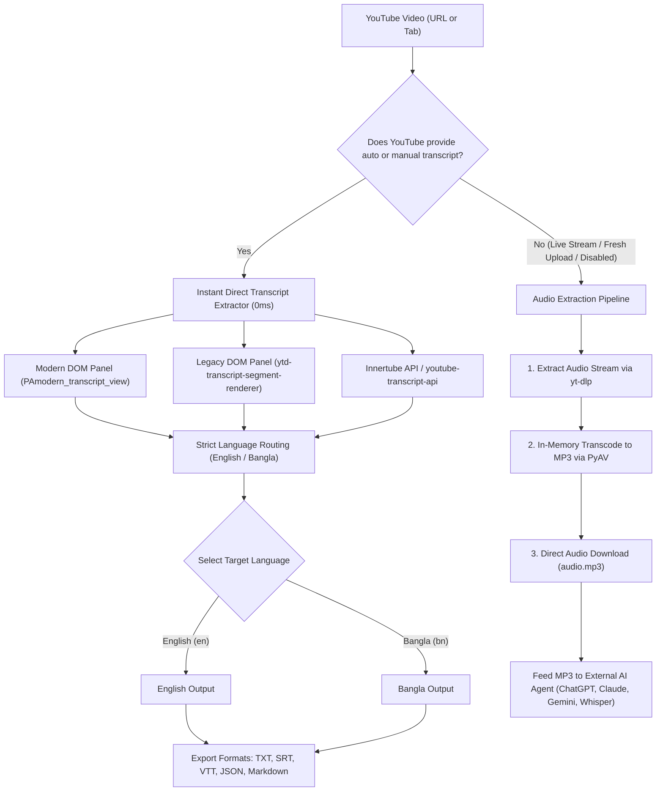

# 🎬 YouTube Transcript Scraper & Downloader

<p align="center">
  
</p>

<p align="center">
  <a href="https://github.com/AkmKawser/Youtube-Transcript-Scrapper/releases"></a>
  <a href="https://github.com/AkmKawser/Youtube-Transcript-Scrapper/releases/latest"></a>
  <a href="https://www.python.org/"></a>
  <a href="LICENSE"></a>
</p>

A high-performance Chrome Extension (Manifest V3) and Python backend for extracting, searching, and exporting YouTube transcripts in **TXT**, **SRT**, **WebVTT**, **JSON**, and **Markdown**.

Engineered with a **smart dual-path architecture**: instantly copies native YouTube transcripts (0ms latency) when available, and automatically extracts high-fidelity **Audio (.mp3)** for videos without captions (such as completed live streams and newly released uploads), allowing users to download the audio and feed it directly into any modern AI agent (ChatGPT, Claude, Gemini, or Whisper) for custom transcription and translation.

---

## 🏗️ System Architecture



### 🎯 Key Architectural Pillars

1. **Direct Native Caption Ingestion (0ms Latency):**
   - Automatically detects and copies native or auto-generated YouTube captions.
   - Fully compatible with YouTube's **2026 Modern Transcript Panel** (`PAmodern_transcript_view` with `<transcript-segment-view-model>`) and legacy panels.
2. **Instant Audio (.mp3) Extraction for AI Agents:**
   - When a video has **no captions** (e.g. newly streamed live videos or newly uploaded videos):
     - Extracts the audio stream with `yt-dlp`.
     - Automatically transcodes into standard `audio.mp3` in 1–2 seconds using in-memory `PyAV` (no external `ffmpeg.exe` required).
     - Allows users to download the `.mp3` with one click and feed it directly to ChatGPT, Claude, Gemini, or Whisper AI.
3. **Strict Two-Language Output Pipeline (`English` & `Bangla`):**
   - Output transcripts are strictly constrained to **English (`en`)** or **Bangla (`bn`)**.
   - Hindi and foreign language sources are automatically converted to English or Bangla.
   - Native Bangla transcripts are cleanly preserved.
4. **Persistent Window & State Recovery:**
   - Includes a dedicated Pop-out Window mode (↗️) so the extension stays open persistently while multitasking.
   - Automatically saves and restores transcripts via `chrome.storage.local`.
5. **Upstream Synchronization:**
   - Seamlessly synchronizes with upstream improvements from [`jdepoix/youtube-transcript-api`](https://github.com/jdepoix/youtube-transcript-api).

---

## 🌟 Key Features

* **⚡ Dual-Mode Integration:**
  * **⚡ In-Browser Direct (Zero-Setup):** Scrapes captions directly from your active YouTube tab using your existing browser session. *Immune to IP bans or HTTP 429 rate-limiting.*
  * **🐍 Python API Mode (`backend/app.py`):** Communicates with local REST backend providing formatters, audio MP3 extraction, and upstream updates.
* **🎵 Direct Audio (.mp3) Download:** One-click download of the video's audio track for videos without captions, ready to feed into any AI agent.
* **↗️ Dedicated Pop-out Floating Window:** Keep the scraper open in an independent window that never dismisses when clicking elsewhere.
* **⏱️ Interactive Clickable Timestamps:** Clicking any timestamp in the transcript automatically seeks the YouTube player to that exact moment.
* **🔍 Real-Time Search & Highlight:** Instantly search through transcript lines with keyword highlighting and match counts.
* **📥 Multi-Format Export:**
  * **Plain Text (`.txt`)** – Continuous text for reading, notes, or LLM prompting.
  * **SubRip (`.srt`)** – Standard timecoded subtitle file for video players.
  * **WebVTT (`.vtt`)** – HTML5 video subtitles.
  * **JSON (`.json`)** – Structured array with `start`, `duration`, and `text`.
  * **Markdown (`.md`)** – Clean timestamped document with headers.
  * **Audio (`.mp3`)** – Full audio file for external transcription or podcast listening.
* **📋 One-Click Copy:** Copy plain text, timestamped transcripts, or Markdown directly to your clipboard.

---

## 📁 Repository Structure

```
Youtube-Transcript-Scrapper/
├── backend/                      # Python backend API & audio engine
│   ├── app.py                    # Flask REST API with CORS, formatters & audio streaming
│   ├── audio_extractor.py        # Audio stream extraction (yt-dlp) + MP3 encoder (PyAV)
│   ├── updater.py                # PyPI/GitHub upstream version checker & updater
│   ├── run_server.bat            # One-click Windows runner
│   └── requirements.txt          # Backend dependencies
├── extension/                    # Chrome Extension (Manifest V3)
│   ├── manifest.json             # Manifest V3 specification
│   ├── popup.html                # Modern popup UI (Dark Theme + Pop-out button)
│   ├── popup.css                 # Responsive YouTube-style styling
│   ├── popup.js                  # Dual-engine controller, state recovery & audio downloader
│   ├── content.js                # In-page extractor, video seek & injected drawer
│   ├── background.js             # Service worker & origin header modifiers
│   └── icons/                    # Extension icons (16, 48, 128)
├── tests/                        # Comprehensive unit tests
│   └── test_scraper.py           # Test suite (URL parser, formatters, audio extractor)
├── cli.py                        # Standalone CLI tool for terminal power-users
├── package_extension.py          # Extension packager script
├── requirements.txt              # Project dependencies
├── LICENSE                       # MIT License
└── README.md                     # Documentation
```

---

## 🚀 Quick Start Guide

### Step 1: Install the Chrome Extension

1. Open Google Chrome and navigate to: `chrome://extensions/`
2. Enable **Developer mode** using the toggle switch in the top right corner.
3. Click the **"Load unpacked"** button in the top left.
4. Select the `extension/` folder inside this repository:
   ```
   c:\Users\USER\Documents\.MYGITHUB\Youtube-Transcript-Scrapper\extension
   ```
5. Pin the extension to your Chrome toolbar.

---

### Step 2: Start the Python Backend (Optional for Audio MP3 Extraction)

To enable Audio MP3 extraction for live streams and videos without captions:

1. Double-click `backend/run_server.bat` (on Windows), **OR** run in terminal:
   ```bash
   # Activate virtual environment
   .venv\Scripts\activate

   # Install dependencies
   pip install -r backend/requirements.txt

   # Run backend API
   python backend/app.py
   ```
2. The server starts on `http://127.0.0.1:5000`.
3. The extension automatically detects the server and illuminates a green status pill.

---

## 💻 CLI Usage

You can also scrape transcripts and extract audio directly from the command line:

```bash
# 1. Scrape standard YouTube video transcript to TXT
python cli.py https://www.youtube.com/watch?v=dQw4w9WgXcQ --format txt

# 2. Extract subtitles as SRT file translated into Bangla
python cli.py dQw4w9WgXcQ --translate bn --format srt -o subtitles_bn.srt

# 3. Extract and download audio (.mp3) for use with AI agents
python cli.py https://www.youtube.com/watch?v=5J2eSSgLD40 --audio -o audio.mp3

# 4. Check for upstream library updates
python cli.py --check-update
```

---

## 🛠️ REST API Reference

The backend exposes clean REST endpoints:

| Endpoint | Method | Description |
| :--- | :--- | :--- |
| `/health` | `GET` | Health check, installed version, and audio extractor status |
| `/api/languages?video_id={id}` | `GET` | Lists available native and translated caption languages |
| `/api/transcript?video_id={id}&format={txt\|srt\|vtt\|json\|md}` | `GET` | Fetches transcript (provides audio download fallback if no captions exist) |
| `/api/audio?video_id={id}` | `GET` | Transcodes and streams `audio.mp3` as an attachment |
| `/api/update` | `POST` | Upgrades core `youtube-transcript-api` package on the fly |

---

## 📄 License

This project is licensed under the MIT License - see the [LICENSE](LICENSE) file for details.

